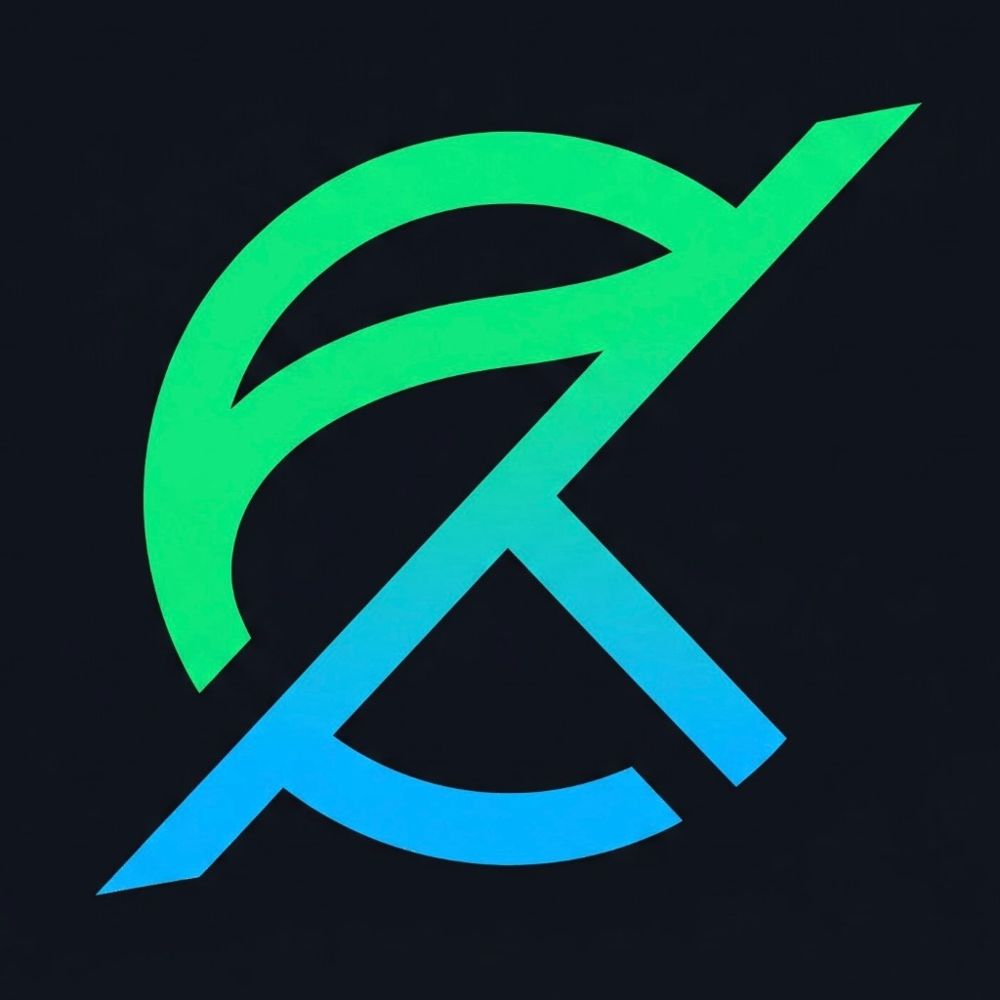
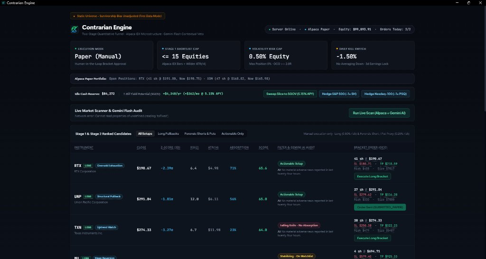
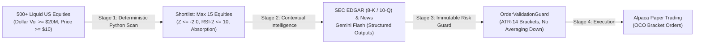

<div align="center">

  

  # Contrarian Engine

  <p><strong>A personal quantitative research engine & swing-trading pipeline designed to identify high-asymmetry pullback opportunities in liquid US equities.</strong></p>

  <p>
    
    
    
    
    
    
    
  </p>

</div>

---

> [!NOTE]
> **Personal Research Project Disclaimer**: This repository is a personal quantitative engineering sandbox built to explore algorithmic scanning, SEC filing extraction, and asymmetric swing-trading mechanics (holding horizon: 3 to 20 trading sessions). It is maintained solely for personal study, backtesting, and paper-trading simulation. **It does not provide financial advice, recommendations, or autonomous live money execution.**

---

<p align="center">
  
  <em style="color: #8b949e;">Dark-Mode Quantitative Command Center with real-time candidate triage, AI contextual audits, and volatility-adjusted bracket order sizing.</em>
</p>

---

## 💡 The Core Philosophy: "Filter First, LLM Second"

Modern financial APIs and LLM inference can easily become slow, expensive, and noisy if applied indiscriminately. **Contrarian Engine** enforces a rigorous **two-stage funnel**:



1. **Deterministic Pre-Scanner (`src/scanner/`):** Python evaluates price drops and statistical extremes across ~500 equities. It flags genuine technical exhaustion (e.g., $RSI_2 \le 10$, structural support, late-day VWAP absorption) and shrinks the universe to **$\le 15$ candidates daily**.
2. **Contextual Intelligence (`src/intelligence/`):** Primary SEC filings (`8-K`, `10-Q`) and deduplicated news clusters are analyzed with Gemini Flash (`temperature=0.0`, strict Pydantic schemas) to extract verifiable facts and enforce **instant red-flag vetoes** (e.g., accounting fraud, unexpected dilution, critical litigation).
3. **Zero-Trust LLM Math:** All position sizing, volatility math ($ATR_{14}$ multipliers), and risk calculations are executed purely in Python. The LLM has **VETO power only** and never calculates order quantities or touches trade execution.

---

## 🎯 Analytical Engines

The system evaluates shortlisted equities across four specialized contrarian hypotheses:

| Engine | Core Mechanism | Technical Trigger |
| :--- | :--- | :--- |
| **Negative Overreaction** | Identifies severe price sell-offs where market reaction is disproportionate to actual fundamental deterioration. | $Z \le -2.0$, $RSI_2 \le 10$, volume climax stabilization. |
| **Narrative Divergence** | Exploits discrepancies between sensationalist financial headlines and official SEC primary disclosures. | Discrepancy score $\ge 0.65$ with price holding above key support. |
| **Sentiment Inflection** | Catches early institutional narrative transitions from extreme panic to accumulation. | Relative sentiment turning positive + price consolidation. |
| **Forensic Contagion & Absorption** | Detects sympathetic pullbacks driven by sector ETF redemptions or competitor bankruptcies where the target firm's cash flows remain unharmed. | Form 4 insider discretionary buying, SEC text-diff stability, intraday institutional VWAP absorption. |

---

## 🛡️ Immutable Risk Guardrails (`OrderValidationGuard`)

Trading safety is enforced at the code level through strict Python constraints:

- 🚫 **No Averaging Down:** The system physically blocks any buy order for a ticker currently held at an unrealized loss.
- 🎯 **Mandatory Bracket Orders (OCO):** Every entry order submitted to Alpaca is an atomic bracket order containing both a server-side `stop_loss` (calibrated dynamically to $ATR_{14} \times 2.0$) and a `take_profit` ($R:R \ge 2.0$).
- 📅 **Earnings Blackout Filter:** Automatically vetoes entries if a company has an earnings announcement scheduled within the next 3 trading sessions.
- 🔒 **Execution Lock:** Defaults to `RESEARCH`. `PAPER` routes exclusively to Alpaca Sandbox (`paper-api.alpaca.markets`). Live production trading is strictly blocked and raises a `RuntimeError`.

---

## 🚀 Quickstart & Setup

Follow these steps to run the engine locally for research and paper trading.

### 1. Prerequisites
- **Python 3.12+**
- **Git**
- *(Optional)* [uv](https://github.com/astral-sh/uv) (recommended for fast package management)

### 2. Clone the Repository
```bash
git clone https://github.com/danielpasquini/contrarian-research-engine.git
cd contrarian-research-engine
```

### 3. Create Virtual Environment & Install Dependencies

Using `uv` (recommended):
```bash
uv sync --all-extras
```

Or using standard `pip`:
```bash
python -m venv .venv
# On Windows:
.venv\Scripts\activate
# On Linux/macOS:
# source .venv/bin/activate

pip install -e ".[providers,dev]"
```

### 4. Configure Environment Variables
Copy the example environment template and fill in your API credentials:
```bash
cp .env.example .env
```

Key environment variables to configure:
- `GEMINI_API_KEY`: Your Google Gemini API key (for contextual news/filing audits).
- `ALPACA_API_KEY` & `ALPACA_SECRET_KEY`: Your Alpaca Paper Trading API keys.
- `SEC_USER_AGENT`: In accordance with SEC fair-access policy, set your `Name email@domain.com`.
- `EXECUTION_MODE`: `research` (default) or `paper`.

### 5. Run Database Migrations
Initialize your local PostgreSQL / SQLite schema:
```bash
uv run alembic upgrade head
# Or with active venv: alembic upgrade head
```

### 6. Launch the Command Center
Start the local FastAPI application and open the interactive dashboard:
```bash
uv run python app.py
# Or with active venv: python app.py
```
The application will launch your default browser to `http://127.0.0.1:8501`, featuring:
- Real-time market scanner candidates.
- Interactive AI audit inspection with source citation tracking.
- Volatility-adjusted bracket sizing calculator.
- Human-in-the-loop paper order submission.

---

## 🧪 Testing & Verification

The engine is covered by an extensive offline test suite enforcing architectural boundaries, point-in-time timestamp integrity, and risk invariants:

```bash
uv run pytest
```

Output:
```text
84 passed in 2.24s
```

Included test suites:
- `tests/unit/`: Deterministic testing of indicators, Alpaca adapters, and SEC parsers.
- `tests/invariants/`: Mathematical validation of ATR sizing and Bracket OCO generation.
- `tests/constraints/`: AST-level architecture boundary checks (e.g., verifying LLMs never import execution SDKs).

---

## 📂 Project Structure

```text
contrarian-research-engine/
├── .agents/             # Quantitative skills & architectural rules
├── alembic/             # Database schema versioning
├── dashboard/           # Win11 dark-mode UI & command center components
├── docs/                # Mathematical specs & architecture blueprints
│   ├── ARCHITECTURE.md
│   ├── DATA_DICTIONARY.md
│   ├── SPEC.md
│   ├── STRATEGY_HYPOTHESES.md
│   └── VALIDATION_PROTOCOL.md
├── src/
│   ├── api/             # FastAPI local telemetry & manual order endpoints
│   ├── execution/       # Alpaca Paper Trading adapter & order routers
│   ├── fundamentals/    # SEC EDGAR parser & earnings calendar
│   ├── ingestion/       # Historical OHLCV & raw data stores
│   ├── intelligence/    # Gemini Flash contextual audits & sanitizer
│   ├── normalization/   # Point-in-time timestamps & news deduplication
│   ├── risk/            # OrderValidationGuard & dynamic ATR sizing
│   ├── scanner/         # Pre-filter scanner & technical indicators
│   ├── strategies/      # Negative Overreaction, Divergence & Contagion engines
│   └── orchestrator.py  # Daily pipeline orchestration
├── tests/               # Comprehensive pytest test suite
├── app.py               # Main application entrypoint
├── pyproject.toml       # Python package configuration & linting rules
└── README.md            # Project documentation
```

---

## 📑 Deep-Dive Documentation

For complete mathematical definitions and design rationales, refer to the documents in `docs/`:
- **[System Specification](docs/SPEC.md):** Functional requirements and acceptance criteria.
- **[Architecture Blueprint](docs/ARCHITECTURE.md):** Modular monolith design and fail-closed security.
- **[Data Dictionary](docs/DATA_DICTIONARY.md):** Three-timestamp point-in-time data contracts.
- **[Strategy Hypotheses](docs/STRATEGY_HYPOTHESES.md):** Quantitative scoring formulas and exit conditions.
- **[Validation Protocol](docs/VALIDATION_PROTOCOL.md):** Guidelines for preventing look-ahead and survivorship bias.

---

## ⚖️ License & Terms

This is a personal, private research project created by Daniel Pasquini. Distributed for educational and quantitative research purposes only.
