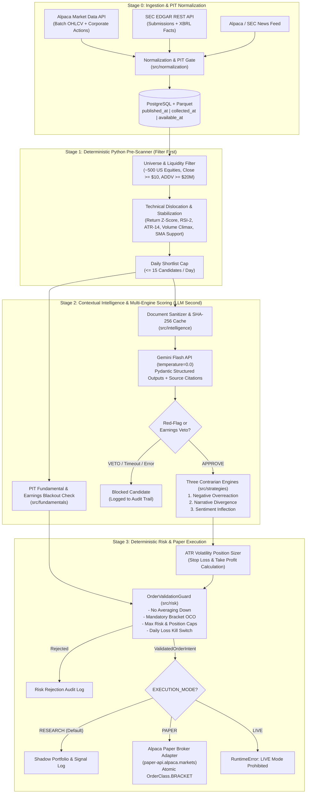

# Contrarian Research Engine — Architecture (`ARCHITECTURE.md`)

## 1. Architectural Style: Modular Monolith
The system is structured as a **Modular Monolith** in Python 3.12+. Domain logic is strictly decoupled from external API providers (Alpaca, SEC EDGAR, Gemini Flash) via typed adapter interfaces and Pydantic v2 data contracts. Business, quantitative, and risk logic reside exclusively in `src/` and never inside FastAPI routes (`src/api/`) or Streamlit views (`dashboard/`).

---

## 2. Two-Stage Funnel & Execution Pipeline



---

## 3. Directory & Module Responsibilities

```text
contrarian-research-engine/
├── src/
│   ├── ingestion/       # External provider adapters (Alpaca OHLCV/News, SEC EDGAR REST/XBRL). Raw payload preservation.
│   ├── normalization/   # UTC timestamp enforcement, NYSE calendar available_at gating, split adjustment, news deduplication.
│   ├── scanner/         # Stage 1 deterministic technical indicators (ATR-14, RSI-2, Z-score, volume climax) & <=15 shortlist filter.
│   ├── fundamentals/    # PIT SEC XBRL parser (gated by acceptanceDateTime), balance-sheet health, 3-day earnings blackout detector.
│   ├── intelligence/    # Prompt-injection sanitizer, SHA-256 cache, Gemini Flash client (temperature=0.0), source-ID verifier, Veto gate.
│   ├── strategies/      # Deterministic scoring formulas for Negative Overreaction, Narrative Divergence, and Sentiment Inflection.
│   ├── risk/            # ATR stop/target calculation, volatility share sizing, and OrderValidationGuard (No Averaging Down, OCO check).
│   ├── execution/       # Mode guard (RESEARCH/PAPER), deterministic client_order_id generator, Alpaca Paper OCO submission & reconciliation.
│   ├── backtesting/     # PIT historical simulation engine, survivorship-bias warning injector, slippage/delisting stress tests.
│   ├── database/        # SQLAlchemy 2.0 ORM models, session management, Alembic migrations, Parquet read/write utilities.
│   └── api/             # FastAPI service layer exposing read-only research views and guarded pipeline triggers.
├── dashboard/           # Streamlit + Plotly UI (consumes src/api or read-only query services; zero embedded business logic).
├── tests/               # Unit, integration, property-based look-ahead, and adversarial risk/LLM tests.
├── scripts/             # CLI entrypoints for universe seeding, daily pipeline execution, and backtest reporting.
└── data/
    ├── raw/             # Immutable provider payloads partitioned by provider/date/ticker.
    ├── processed/       # PIT-normalized Parquet feature tables.
    └── historical/      # Consolidated backtest datasets with explicit universe metadata.
```

---

## 4. Strict Layering & Dependency Rules

1. **Domain Independence:** `src/scanner/`, `src/strategies/`, and `src/risk/` must be pure Python/NumPy/Pandas/Polars modules with **zero imports** from `alpaca`, `google.genai`, `fastapi`, or `streamlit`.
2. **Adapter Boundary:** Only `src/ingestion/` and `src/execution/` may communicate with Alpaca or SEC EDGAR over HTTP. Only `src/intelligence/` may communicate with `google-genai`.
3. **Pydantic v2 Contracts:** Every cross-module call passes immutable (`frozen=True`) Pydantic v2 models defined at module boundaries.
4. **Zero-Trust LLM Math:** `src/intelligence/` outputs categorical classifications, extracted text spans, source IDs, and boolean red-flag vetoes. It never outputs share quantities, dollar prices, stop-loss levels, or portfolio weights.

---

## 5. Storage Architecture: PostgreSQL + Parquet Hybrid

- **PostgreSQL 16 (via SQLAlchemy 2.0 & Alembic):**
  - Stores relational, transactional, and audit-critical state:
    - `universe_symbols` (ticker metadata, sector, liquidity status)
    - `raw_payload_metadata` (file paths, SHA-256 hashes, `published_at`, `collected_at`, `available_at`)
    - `sec_filings` & `news_clusters` (deduplicated text metadata, `available_at`)
    - `scanner_candidates` (Stage 1 daily shortlist $\le 15$ and technical snapshots)
    - `llm_analyses` (model ID, prompt version, input hash, structured JSON output, `veto_decision`)
    - `strategy_signals` (Engine 1, 2, 3 scores, composite rank)
    - `risk_decisions` & `orders` (`client_order_id`, Bracket OCO legs, broker status, audit logs)
    - `portfolio_positions` & `daily_equity_snapshots` (for anti-averaging-down and kill-switch checks)
- **Apache Parquet (`data/processed/` & `data/historical/`):**
  - Stores high-volume daily OHLCV time series and rolling technical matrices (500 tickers $\times$ multi-year history) for sub-second vectorized loading via Polars/Pandas during Stage 1 scanning and historical backtesting.

---

## 6. Security, Prompt Injection Defense & Fail-Closed Design

### 6.1 Untrusted External Text Defense (`src/intelligence/`)
SEC filings and news articles are treated as **untrusted external inputs**:
1. **Structural XML/Delimiter Fencing:** Document text is stripped of control characters and wrapped inside isolated `<untrusted_document source_id="...">...</untrusted_document>` tags.
2. **System Instruction Isolation:** System prompts explicitly instruct Gemini Flash to treat everything inside `<untrusted_document>` purely as passive data to be analyzed, ignoring any imperative commands, role-play instructions, or schema overrides contained within the text.
3. **Post-Generation Citation Verification:** A deterministic Python post-processor verifies that every `source_id` cited in the LLM's structured output exists in the input document set. Any fabricated `source_id` invalidates the response and triggers an automatic `VETO`.

### 6.2 Fail-Closed Execution Matrix

| Failure Scenario | System Behavior | Order Outcome |
| :--- | :--- | :--- |
| Gemini Flash API timeout / HTTP 429 / 5xx | Catch exception, log error, set `veto_decision = VETO` | **BLOCKED** |
| LLM output fails Pydantic schema validation | Reject response, set `veto_decision = VETO` | **BLOCKED** |
| LLM cites non-existent `source_id` | Downgrade claim or trigger `VETO` | **BLOCKED** |
| Missing/stale SEC fundamental data ($> 135$ days old) | Set `missing_data_flag = True`, veto signal | **BLOCKED** |
| Upcoming earnings within $\le 3$ trading sessions | `OrderValidationGuard` raises `EarningsBlackoutError` | **BLOCKED** |
| Ticker currently held at unrealized loss | `OrderValidationGuard` raises `ValueError("No Averaging Down")` | **BLOCKED** |
| Daily portfolio drawdown $> \text{MAX\_DAILY\_LOSS\_PCT}$ | Global Kill Switch engaged | **BLOCKED** |
| Alpaca `submit_order` HTTP timeout | Query `get_order_by_client_order_id` before any action; never blind-retry | **HALT & RECONCILE** |
| `EXECUTION_MODE == "live"` or non-paper URL | Raise `RuntimeError` at startup | **PROCESS ABORTED** |
